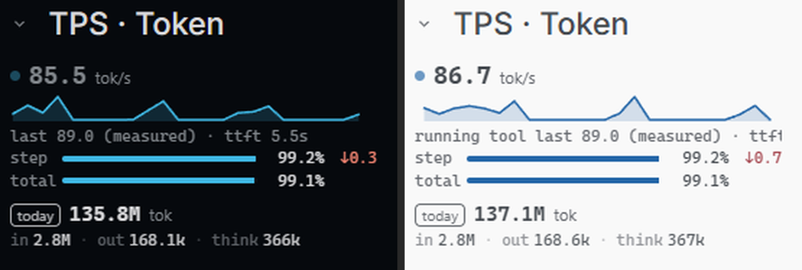
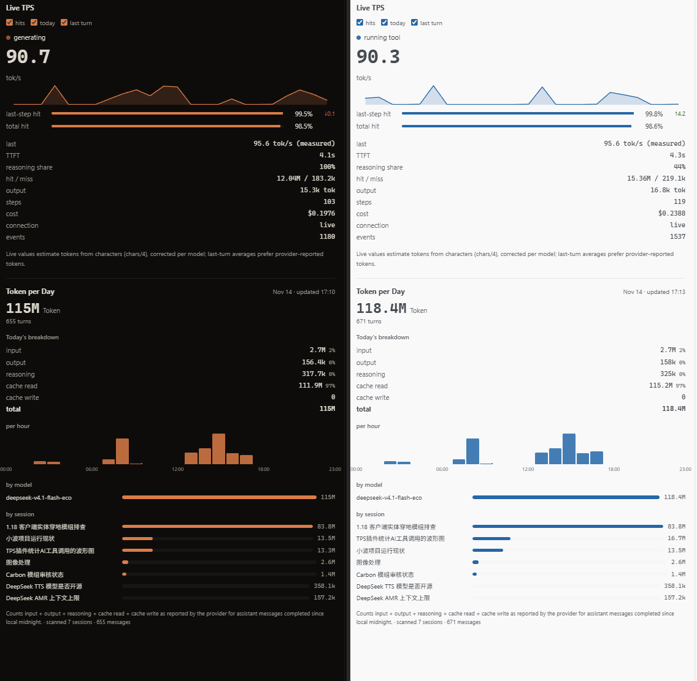

English | [简体中文](README.zh-CN.md)

# OpenChamber Live TPS

A `TPS & Token` section for the Work Status panel: live generation speed for the
open session, the last turn's average and time to first token, and the day's
provider-reported token usage.



`tok/s` here is estimated from streamed characters with a heuristic — there is
no tokenizer. See [Counting](#counting).

## What it shows

| | |
|---|---|
| `Live TPS` | the running turn's average speed, frozen while the model thinks and locked while a tool runs |
| `last … (measured)` | the finished turn's average — `measured` when the provider reported token counts, `estimated` otherwise |
| `ttft` | time to first token |
| Sparkline | the last 30 s of generation rate, one point per 1.25 s |
| `step hit` | cache hit rate of the last settled step (an API call), with the change since the step before; drawn as a bar under the curve |
| `total hit` | cache hit rate of the whole conversation, including its sub-sessions |
| cache details | hit/miss tokens, output tokens, step and sub-session counts, cost |
| `today` tokens | provider-reported total for assistant messages completed since local midnight, with the cache-read amount and the input/output/reasoning split |

The floating panel shows the same numbers with the full breakdown:



## Requirements

- OpenChamber ≥ 2.7.0 (`panels.emit`, `onServiceEvent`, `keepRunning`)
- OpenCode v1.2.19+
- Node.js v22+ on `PATH`

## Install

Open **Settings → Extensions**, paste this URL into **Folder, ZIP, or URL**, and
choose **Add**:

```text
https://github.com/wwwzzzxxx/openchamber-live-tps
```

Approve the local service. The repository includes the built JavaScript files,
so a Git install needs no dependency install or build. OpenChamber offers an
update when the repository publishes a newer package version. Every surface
(desktop, browser, mobile) asks for the service separately, and asking again
after the service restarts is normal.

For development, clone the repository, run `bun install` and `bun run build`,
then add the checkout's absolute path in **Settings → Extensions**.

A Gitee mirror is at `https://gitee.com/pzwzx/openchamber-live-tps` if GitHub is
slow.

## Verify

Open any session, then open the Work Status panel (`Choose sections`) and place
`Live TPS` where you want it. Once the model generates, you should see the
running number above.

```bash
npm test   # smoke plus authentication/calibration regressions
```

## Counting

No tokenizer runs here. A real one would ship a vocabulary per model family into
a bundle that has to load inside a sandboxed guest — and it would not help
anyway, because the live number has to exist before the tokens do. The honest
source would be the `usage` block each provider returns, but that arrives with
the message end, too late to be live.

So the estimate is the heuristic from
[`opencode-tps-meter`](https://github.com/ChiR24/opencode-tps-meter), ported
verbatim into `shared/tokens.ts`: **`Math.ceil(characters / 4)`**, the figure
for general text (that project measures it at ~75% accurate). It also ships
`chars/3` for code and `words/0.75` for English prose, should the default ever
prove wrong for some model.

`last` prefers the real thing: provider-reported token counts replace the
estimate when they arrive, and the value is then labelled `measured`. The
heuristic is only the fallback, labelled `estimated`.

The live number also takes the **calibrated live rate** from that project's v2:
each finished step compares the provider's reported token count against the
heuristic and nudges a per-model correction factor toward the truth (exponential
average, clamped to 0.25–4×). A model that departs from `chars/4` converges on
its own ratio within a step or two, and the factor is persisted alongside the
turn history, so a restart starts from what the service already learned.

It matters what those characters are. The stream carries `text` parts, `reasoning`
parts, and tool-call JSON:

- **Text and reasoning characters count.** They are real model output, and they
  are what a speed number should cover.
- **Tool-call JSON does not.** Its size reflects an argument schema, not
  generation work — one tool with a large `input` can outweigh the entire reply.
  Per step, anything past the first 200 characters of each tool part is excluded.

`ttft` is measured directly from event timestamps, and is exact. For `last`,
provider-reported token counts are preferred when they arrive (these will show as
`measured`), falling back to the character estimate above (`estimated`).

## Cache hits

Both rates come from provider-reported usage, never from the character
heuristic:

```
hit rate = cache.read / (input + cache.read + cache.write) × 100
```

`input` is the prompt tokens billed without a cache hit, `cache.read` the ones
served from cache, and `cache.write` the ones written to it (a write is not a
hit). This is the same formula OpenChamber's own Turn stats use, so the two
numbers agree. A provider that reports no `cache` block only adds to the step
count; it does not draw a misleading 0%.

The conversation total covers the watched session and every child session the
stream places below it (`session.created` names the parent), so a subagent's
calls count toward the same numbers. A session the service attached late to is
asked about through `/api/session/{id}` once, and the step that triggered the
lookup is replayed after the answer. Both the aggregate and the per-turn
history are written beside the service, so OpenChamber can be closed and
reopened without losing them. Counting starts when the service first sees the
session; conversations from before the install are not backfilled.

**Background counting**: the service declares `keepRunning: true`, so OpenChamber starts it
with the app, not with a panel. It subscribes to the global event stream on startup and
treats top-level conversations (and an existing conversation's first execution) as targets,
so the numbers keep accumulating. The eight most recently active top-level conversations
are counted (sub-sessions follow their parent). `contributes.sessionEvents` is declared too,
so the host can push turn boundaries straight to the service. Opening the panel shows what
is already there; the host supervises the process and totals come back from disk.

## Daily tokens

The service also keeps the local day's usage. `session.step.ended` /
`session.step.failed` settle once per **model call** with the provider's
`tokens` and `cost`, and every session counts — watched or not — so the day
stays current with no panel open.

```text
input + output + reasoning + cache read + cache write
```

That is the honest usage number: cache reads are the context every step
re-reads, and they dominate a long session. The status section shows the total,
the cache-read amount, and the input/output/reasoning split; the panel adds the
hourly bars and the top models and sessions. Those figures are pushed with
`createServiceHost(...).emit('day', snapshot)` and repaint on
`host.onServiceEvent`; no timer reads them.

History is read only when it must be: the first run of the day reads today's
assistant messages once; a later start (or a stream reconnect) reads only
messages newer than each session's saved cursor. The cached ledger rolls over at
local midnight.

Day boundaries come from the machine the service runs on (`Date`, no fixed
offset): UTC+8 and every other zone roll over at that zone's own midnight. The
service test suite runs one instance under `TZ=UTC` to prove the day key moves
with the system zone.

## Options

A fresh install draws the waveform and nothing else. The panel carries three
checkboxes — `hits`, `today`, and `last turn` — each off by default:

- **hits** — the step/total cache hit-rate bars and their cache numbers;
- **today** — the provider-reported daily token block;
- **last turn** — the previous turn's average, TTFT, reasoning share, and the
  estimate note.

The choice is saved by the service (`.live-tps-options.json` beside it) and
pushed to both surfaces as an `options` service event, so the status section
follows the panel without polling. While `today` is off the service does not
read daily history at all; switching it on triggers one catch-up.

## Architecture

One local service owns all measurement state; the panel and the Work Status
section are thin views of it.

```
        global event stream
OpenChamber server ─────────────▶ service/  (runs in the host, owns all state)
        │
        │ hosts and proxies
        ├────────────▶ panel/    (floating panel, polls /rate)
        └────────────▶ status/   (Work Status section, polls /rate)
```

- **`service/`** — the only place with state. Reads OpenChamber's global event
  stream, computes live/last-turn/TTFT and the sparkline curve, serves `/rate`
  and `/watch`. Keeps a per-session state map keyed by session id and persists
  the finished-turn history to disk, so the numbers survive an OpenChamber
  restart and two surfaces on different sessions stop fighting over one
  measurement.
- **`panel/`** — the floating panel. Polls `/rate`, draws everything.
- **`status/`** — the `Live TPS` section in the Work Status panel.

Both guests self-heal: if the service was restarted they notice `sessionId: null`
in a `/rate` answer and re-assert `/watch`, which lets the host bring the service
back.

The service finds the event stream on the machine that hosts it, never from the
page alone:

- the desktop's own port (`desktopLocalPort` in `settings.json`) first — this is
  what a Private Relay client needs, because it mounts the page as a self-
  contained `srcDoc` whose location is `about:srcdoc`: no http(s) origin exists
  to report;
- the page's origin when it has one (a browser on this machine or the LAN);
- a probe of the parent process's loopback ports for `/api/global/event`, which
  covers SSH tunnels and headless installs.

A page with no origin therefore still asks `/watch`; a missing origin is not an
error.

### Reading the event stream behind a UI password

The SDK deliberately keeps host secrets out of a service's environment — "API
keys, the UI password, and other host secrets never reach it" — so a service has
no credentialed channel to the server API. `/api/global/event` is open until the
user sets a UI password, after which every `/api/*` route answers 401 and this
extension goes dark.

The service therefore reads `desktopLocalClientToken` out of
`$OPENCHAMBER_DATA_DIR/settings.json` (default `~/.config/openchamber`) and sends
it as `Authorization: Bearer ...`, which is how the OpenChamber CLI authenticates
its own desktop-local API calls. It is a loopback-only credential, meaningless to
anything but an OpenChamber on this machine. Set
`OPENCHAMBER_LIVE_TPS_CLIENT_TOKEN` to pass a token in explicitly instead.

A headless install has no desktop token. When the stream still answers 401, the
service reads `uiPassword` from
`$OPENCHAMBER_DATA_DIR/run/openchamber-<port>.json` (the instance file the host
writes with mode 0600), signs in at `/auth/session`, and sends the resulting
cookie only to that loopback origin. Login and stream requests do not follow
redirects, and `OPENCHAMBER_LIVE_TPS_UI_PASSWORD` can supply the password when
the data directory is not visible to the service; `OPENCHAMBER_DATA_DIR` points
at a non-default one.

The scoped desktop token is always tried first. The password path is the
fallback for a host that cannot issue one, and it does read a secret the SDK
normally keeps out of the service environment — limited to the parent process's
loopback listener.

## Limitations

- Per-provider `usage` fields are normalised where the mapping is known (OpenAI,
  Anthropic, Gemini, Mistral, OpenRouter). An unknown `usage` shape counts as no
  tokens and the turn reports `estimated`.
- A step that produced no measurable output contributes no time and no tokens —
  the average only covers spans where something was actually produced. A
  `reasoning` delta is only a share of output while the step has produced no text.
- The live number is the `chars/4` heuristic corrected by a learned per-model
  factor, so the first step or two of a model it has not seen before can sit away
  from the final `measured` average. A provider that never reports token counts
  stays on the raw heuristic, labelled `estimated`.

## License

MIT
