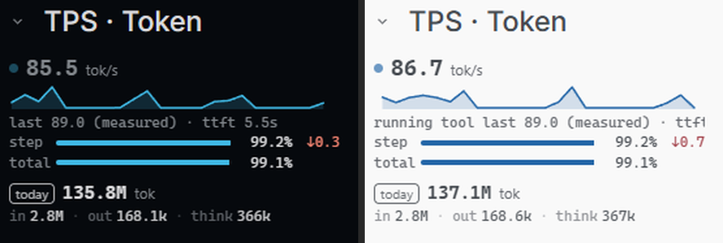
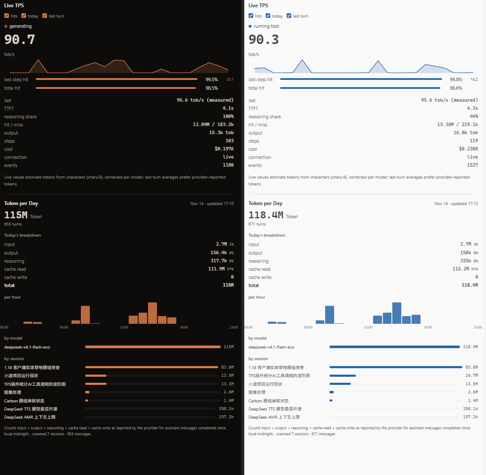

[English](README.md) | 简体中文

# OpenChamber Live TPS

为工作状态面板增加一个 `TPS & Token` 小节：当前会话的实时生成速度，上一轮均值与首字延迟，以及当天由提供商上报的 token 用量。



这里的 `tok/s` 是按字符流用启发式估算的——**没有分词器**。详见[口径](#口径)。

## 显示什么

| | |
|---|---|
| `Live TPS` | 本轮进行中的平均速度；模型思考时冻结，工具执行时锁定 |
| `last … (measured)` | 上一轮完成后的平均值——提供商上报了 token 数就是 `measured`，否则是 `estimated` |
| `ttft` | 首字延迟 |
| 曲线 | 最近 30 秒的生成速率，每 1.25 秒一个点 |
| `单步` | 最近一个结算 step（一次 API 调用）的缓存命中率，以及相对上一步的涨跌；在曲线下方以进度条显示 |
| `累计` | 本次对话（含其子对话）的缓存命中率；同样在曲线下方 |
| 命中数据 | 面板里另有命中/未命中 token、输出 token、步数与子对话数、费用 |
| `今日` Token | 本地自然日内完成的助手消息总量（提供商上报），并给出缓存读取量与输入/输出/推理拆分 |

浮动面板把同样的数字连同完整明细一起显示：



## 依赖

- OpenChamber ≥ 2.7.0（用到 `panels.emit`、`onServiceEvent`、`keepRunning`）
- OpenCode v1.2.19+
- `PATH` 里有 Node.js v22+

## 安装

打开 **设置 → 扩展**，把下面这个地址粘进 **Folder, ZIP, or URL**，点 **Add**：

```text
https://github.com/wwwzzzxxx/openchamber-live-tps
```

然后允许本地服务。仓库里已经带了构建好的 JavaScript，所以从 Git 安装不需要 `bun install` 或构建；仓库发布新版本后 OpenChamber 会提示更新。每个界面（桌面、浏览器、手机）各问一次，service 重启后再问也正常。

要改代码的话，把仓库 clone 下来，跑 `bun install` 和 `bun run build`，再把 checkout 的绝对路径加进 **设置 → 扩展**。

GitHub 慢的话用 Gitee 镜像：`https://gitee.com/pzwzx/openchamber-live-tps`。

## 验证

随便打开一个对话，打开工作状态面板（`Choose sections`），把 `Live TPS` 摆到想要的位置。等模型开始生成，就能看到实时数字。

```bash
npm test   # smoke + 鉴权/校准回归测试
```

## 口径

这里**没有分词器**。真分词器得把各模型家族的词表塞进一个必须在沙箱 guest 里加载的包，而且也帮不上忙——实时值必须在 token 生成出来之前就存在。最诚实的来源是各家提供商返回的 `usage` 块，但它要等消息结束才到，来不及做实时。

所以估算直接用 [`opencode-tps-meter`](https://github.com/ChiR24/opencode-tps-meter) 的启发式，原样搬到 `shared/tokens.ts`：**`Math.ceil(字符数 / 4)`**，通用文本的经验值（按那个项目自己的测算约 75% 准）。它还带 `字符/3`（代码）和 `词数/0.75`（英文散文）两套备选。

`last` 优先用真数：提供商上报了 token 数就覆盖估算值，标 `measured`；启发式只是兜底，标 `estimated`。

实时值还叠加了那个项目 v2 的 **calibrated live rate**：每个完成的 step 拿提供商上报的真 token 数和启发式对一次，把「按模型学习」的修正系数朝真值推（指数平均，夹在 0.25–4 倍）。偏离 `字符/4` 的模型一两轮内就收敛到自己的比例，系数和轮次历史一起落盘，重启后接着之前学到的走。

数的是哪些字符有讲究。事件流里有 `text`、`reasoning` 和工具调用 JSON：

- **文本和推理字符计入。** 它们是模型真实产出，速度指标就该覆盖它们。
- **工具调用 JSON 不计。** 它的大小反映的是参数 schema，不是生成工作量——一个 `input` 很大的工具调用能压过整段回复。每一步里，每个工具部分超出开头 200 字符的内容都被排除。

`ttft` 直接从事件时间戳测出来，是精确值。`last` 优先用提供商上报的 token 数（显示为 `measured`），拿不到才退回字符估算（`estimated`）。

## 缓存命中

两个命中率都来自提供商上报的 usage，不掺字符估算：

```
命中率 = cache.read / (input + cache.read + cache.write) × 100
```

`input` 是未命中缓存、按普通输入计费的 prompt token，`cache.read` 是命中缓存的部分，
`cache.write` 是写入缓存的部分（写入不算命中）。这与 OpenChamber 自己的「Turn stats」
用的是同一个公式，两处数字一致。不上报 `cache` 的提供商只计入步数，不会画出一个误导性的 0%。

累计口径覆盖被 watch 的会话以及流里挂在它下面的所有子会话（`session.created` 带
`parentID`），所以子代理的调用也计入同一组数字。服务启动晚了才接上的会话，会通过
`/api/session/{id}` 查一次父会话，并把触发查询的那一步补算进去。累计值和每轮历史都写在
service 旁边的状态文件里，关掉 OpenChamber 再打开不会丢。统计从服务第一次看到该会话开始，
装扩展之前的对话不回填。

**后台统计**：service 声明了 `keepRunning: true`，OpenChamber 启动时会直接把它拉起，不以任何面板为条件；
service 启动后立刻订阅全局事件流，把新的顶层会话（以及已有会话的第一次执行）记为统计对象，
所以数字一直在后台累计。最近活跃的 8 个顶层对话会被计入（子对话跟随父对话）。
同时声明了 `contributes.sessionEvents`，宿主会在轮次起止时直接推事件给 service（更早唤醒、补齐父链）。
打开面板时直接读到已有结果；崩溃由宿主监督重拉，累计值和历史从磁盘恢复。

## 每日 Token

服务同时维护当天的用量。每次**模型调用**结束（`session.step.ended` / `session.step.failed`）都会带上提供商结算后的 `tokens` 和 `cost`；无论有没有页面在看、是不是当前会话，都会计入当天，所以关掉面板也不会漏。

```text
输入 + 输出 + 推理 + 缓存读取 + 缓存写入
```

这才是真实的用量口径：缓存读取是每一步重新读入的上下文，长会话里占绝对多数。状态区显示总量、缓存读取量以及输入/输出/推理拆分；面板再补上按小时柱状图和按模型/按会话排行。这些数字通过 `createServiceHost(...).emit('day', snapshot)` 推送，页面用 `host.onServiceEvent` 重绘，**不靠定时读取**。

历史只在必要时读：当天第一次运行完整读一遍今天已完成的助手消息；之后启动或事件流重连只读各会话游标之后的新消息。过了本地零点自动换天。

换天用的是**服务进程所在机器的系统时间**（`Date`，没有写死 +08:00）：东八区在本地零点换天，其他时区也在各自时区的零点换天。测试里专门用 `TZ=UTC` 起了一个实例，确认 day key 会跟着系统时区走。

## 选项

全新安装只画波形，不显示其他内容。面板上方有三个勾选框，默认全部关闭：

- **命中率** —— 单步/累计缓存命中条和缓存数字；
- **今日统计** —— 提供商上报的当天 Token 明细；
- **上轮明细** —— 上轮均值、首字延迟、推理占比和估算说明。

选择由服务保存（旁边 `.live-tps-options.json`），并通过 `options` 服务事件推给两个界面，状态区跟着面板走，不轮询。`今日统计` 关闭时服务完全不读当天历史；打开时补一次。

## 架构

只有一个本地 service 持有全部测量状态，面板和工作状态小节都只是它的视图。

```
        全局事件流
OpenChamber server ─────────────▶ service/  （跑在 host 里，持有全部状态）
        │
        │ 托管 + 代理
        ├────────────▶ panel/    （浮动面板，轮询 /rate）
        └────────────▶ status/   （工作状态小节，轮询 /rate）
```

- **`service/`** —— 唯一有状态的地方。读 OpenChamber 的全局事件流，算实时/上轮/首字和曲线，对外提供 `/rate` 和 `/watch`。按 session id 维护一份 per-session 状态表，并把已完成轮次的历史写到磁盘，于是数字能扛住 OpenChamber 重启，两个界面看不同会话时也不会互相抢同一个测量窗口。
- **`panel/`** —— 浮动面板。轮询 `/rate`，负责画。
- **`status/`** —— 工作状态面板里的 `Live TPS` 小节。

两个界面都会自愈：service 重启后，它们发现 `/rate` 里 `sessionId: null` 就会重新 `/watch`，让 host 把 service 拉回来。

service 在**它所在的机器上**找事件流，不再只听页面的一面之词：

- 先读桌面端自己的端口（`settings.json` 里的 `desktopLocalPort`）。Private Relay 客户端正需要这一条：它把页面当作自包含的 `srcDoc` 加载，地址是 `about:srcdoc`，压根没有 http(s) origin 可以上报；
- 页面自己有 origin 时（本机或局域网浏览器）用它；
- 最后才探测父进程的回环端口找 `/api/global/event`，覆盖 SSH 隧道和无桌面端的安装。

所以拿不到 origin 的页面照样会发 `/watch`，没有 origin 不是错误状态。

### UI 密码下怎么读事件流

SDK 刻意不让 service 继承 host 环境——「API key、UI 密码和其他 host 密钥永远不会到 service 手里」——所以 service 没有任何能带凭证访问 server API 的通道。用户没设 UI 密码时 `/api/global/event` 是开放的；一旦设了，所有 `/api/*` 都回 401，这个扩展就瞎了。

所以 service 会从 `$OPENCHAMBER_DATA_DIR/settings.json`（默认 `~/.config/openchamber`）里读 `desktopLocalClientToken`，以 `Authorization: Bearer ...` 发出去——这正是 OpenChamber CLI 自己做本机 API 调用时的鉴权方式。它只是一个回环凭证，只对本机的 OpenChamber 有意义。也可以用 `OPENCHAMBER_LIVE_TPS_CLIENT_TOKEN` 显式指定。

无界面安装没有这个 token。事件流仍然回 401 时，service 会从 `$OPENCHAMBER_DATA_DIR/run/openchamber-<port>.json`（host 写出的实例文件，权限 0600）里读 `uiPassword`，在 `/auth/session` 登录，然后只把拿到的 cookie 发回同一个回环地址。登录和事件请求都不跟随重定向；数据目录对 service 不可见时，可以用 `OPENCHAMBER_LIVE_TPS_UI_PASSWORD` 直接给密码，或用 `OPENCHAMBER_DATA_DIR` 指向非默认目录。

作用域更窄的桌面 token 永远先试；密码只是拿不到 token 的 host 的兜底。它确实读了 SDK 通常不让 service 接触的 host 密钥，所以只限父进程自己的回环监听端口。

## 已知边界

- 各家提供商的 `usage` 字段只在映射关系已知时归一化（OpenAI、Anthropic、Gemini、Mistral、OpenRouter）。遇到不认识的 `usage` 结构就当作没有 token，本轮报 `estimated`。
- 一个没有任何可测产出的 step，不贡献时间也不贡献 token——平均值只覆盖真正吐出东西的时段。`reasoning` 的 delta 只在该 step 还没出文本时才算进产出占比。
- 实时值是 `字符/4` 启发式再乘一个「按模型学习」的修正系数，所以没见过的模型头一两轮可能和最终 `measured` 均值有偏差。完全不上报 token 数的提供商会一直用原始启发式，标 `estimated`。

## License

MIT
